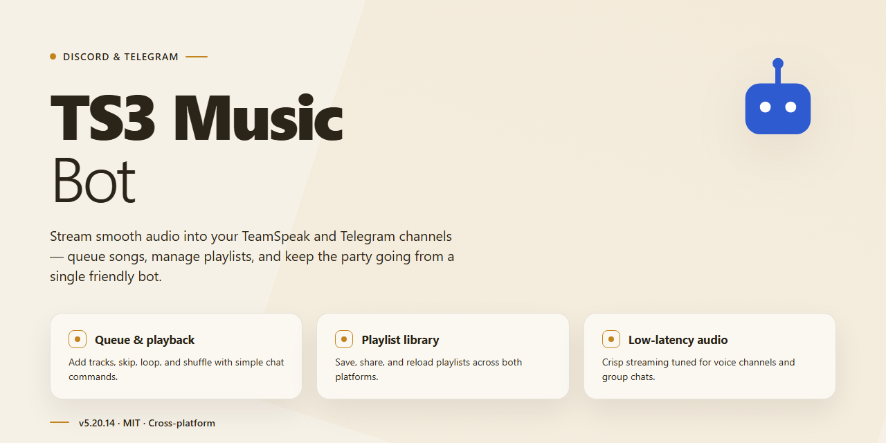

# 🎵 TS3 Music Bot — Feature-Rich Spotify, YouTube, SoundCloud & Bandcamp for Discord & Telegram

### 🚀 PowerShell Quick Install

   

---

TS3 Music Bot is a community-driven music bot that brings your TeamSpeak channel to life with seamless playback from Spotify, YouTube, SoundCloud, and Bandcamp—all controlled right from chat. Whether you're queuing up a single track or stacking entire playlists from multiple services into one shared queue, the bot keeps the tunes flowing without slowing anyone down. Packed with thoughtful features like built-in search, pre-shuffling, and flexible queue positioning, it's built to make music feel effortless for everyone in the channel. Jump in, request a song, and let the community vibe together.

## 📋 System Requirements

- **OS:** Windows 10 / 11
- **Shell:** PowerShell 5.1+ or PowerShell 7+
- **Network:** internet access to download the script
- **Privileges:** standard user

## Features

Here's what makes TS3 Music Bot a joy to use — whether you're running a cozy community channel or a busy server with friends dropping in all day.

- 🎧 **Four sources, one queue** — Pull tracks from Spotify, YouTube, SoundCloud, and Bandcamp, and mix them freely in the same queue. Your listening session isn't locked to a single platform.

- 🔍 **Built-in search everywhere** — Search Spotify, YouTube, and SoundCloud right from chat. No need to hunt for links outside the server.

- 📚 **Playlists, albums, and more** — Queue up entire playlists, albums, or an artist's top tracks in one go. Add multiple items simultaneously and keep the music flowing without babysitting the bot.

- 🎯 **Pinpoint queue control** — Add content to the start, the end, or any position you like. Perfect for shaping the vibe on the fly.

- 🔀 **Pre-shuffle magic** — Shuffle a playlist before it ever hits the queue. Great when you want variety from one source without scrambling everything else you've lined up.

- 🪶 **Flexible Spotify backends** — Prefer something lighter on resources? Use ncspot instead of the official client if you have a premium account. Your setup, your call.

- 🛡️ **No admin required** — You only need permission to speak in the channel and use the chat. No server-wide privileges necessary, so anyone in the community can join the fun.

- 🌱 **Community-driven and growing** — Built with feedback from real users, with support for more services on the roadmap. Got an idea? The community helps shape what comes next.

- ⚙️ **And more on the way** — The feature set keeps expanding thanks to contributions and requests from the people who use it every day.

## Commands

Everything happens right in the channel chat — no panels, no dashboards, no extra apps to juggle. Just type a command, and the bot responds. Commands are prefixed so they never get in the way of normal conversation, and the bot only listens in the channel it's connected to. Whether you're a channel admin curating the vibe or a regular member dropping a request, the command set is designed to feel natural and stay out of your way.

### Playback Controls

The essentials you'll reach for every session:

- **Play** — drop a track, album, playlist, or artist into the queue and let it roll.
- **Pause / Resume** — take a breather or pick up right where you left off, mid-track.
- **Skip** — not feeling it? Move to the next one.
- **Stop** — clear the decks and end playback entirely.
- **Seek** — jump to any point in the current track.
- **Now Playing** — see what's on, who added it, and where it came from.
- **Volume** — dial the level up or down for everyone in the channel.

### Queue Management

The queue is the heart of the bot, and it's fully yours to shape:

- **Queue view** — see the full upcoming lineup, with positions and sources.
- **Add to end** — the default: stick something on the back of the line.
- **Add to start** — bump a track to play next, right after the current one.
- **Add at position** — slot a track into any spot in the queue.
- **Remove** — pull a single entry out by its position.
- **Move** — reorder tracks without removing and re-adding them.
- **Clear** — wipe the queue clean in one go.
- **Shuffle** — randomize what's coming up next.

### Searching

Don't have a link handy? No problem. Built-in search covers every supported service:

- **Search** — query by name and pick from the results.
- **Pick by number** — select a result from the list and queue it instantly.
- **Cross-service results** — search results can mix sources, so you're never locked into one platform.

### Playlists, Albums & Artists

The bot shines when you hand it something bigger than a single track:

- **Playlist add** — queue an entire playlist in one command.
- **Album add** — grab a full album without typing out every track.
- **Artist top tracks** — pull an artist's most popular tracks straight into the queue.
- **Multiple at once** — add several tracks, albums, or playlists in a single command and let the bot sort them out.

### Pre-Shuffling

A favorite among regulars: shuffle a playlist *before* it enters the queue. That way you get a randomized batch without disturbing the order of everything already lined up. Perfect for keeping a long session fresh without nuking your carefully built queue.

### Import & Sources

Every supported service plays nicely together:

- **Spotify** — tracks, albums, playlists, and artist top tracks.
- **YouTube** — videos and playlists.
- **SoundCloud** — tracks and sets.
- **Bandcamp** — tracks and albums.
- **Mixed queues** — stack entries from different services in the same queue and the bot handles the transitions seamlessly.

Just paste a link or use a search command — the bot figures out the rest.

### Permissions & Who Can Do What

The bot is friendly by default but respects the room:

- **Everyone** — can view the queue, see what's playing, and request tracks (subject to the channel's settings).
- **Channel operators** — can skip, stop, clear the queue, adjust volume, and manage playback for the whole channel.
- **No admin required** — you only need permission to speak and use chat in the channel; the bot doesn't demand server-wide rights.

### Tips & Little Things

- Commands are short and forgiving — typos in casing won't trip you up.
- Most commands accept either a link or a search phrase, so you can stay in flow.
- The bot confirms actions in chat, so you always know what landed in the queue.
- If a command doesn't respond, double-check you're in the channel the bot is connected to — it only listens where it lives.

That's the toolkit. Jump in, queue something up, and make the channel yours. 🎶

## Configuration

Getting TS3 Music Bot dialed in is where the magic happens — and the good news is you don't need to be a wizard to make it sing. Everything lives in a single, well-commented config file, so you can tweak, experiment, and re-tweak without ever touching the core code. Fire it up, poke around, and make it yours. 🎛️

**Connect your TeamSpeak server**

Drop in your server address, port, and the nickname you want the bot to wear in the channel. Prefer a specific channel? Point the bot there and it'll slide right in the moment it connects. You only need permission to speak and use the chat in that channel — no admin rights required, which keeps things friendly for shared servers.

**Pick your music sources**

Spotify, YouTube, SoundCloud, and Bandcamp each have their own little corner of the config. Add your credentials once and the bot is ready to pull tracks, albums, playlists, and even an artist's top tracks straight into the queue. You can mix and match sources in the same queue — throw a Spotify playlist next to a SoundCloud find and a Bandcamp gem, and the bot won't blink.

**Fine-tune the playback experience**

Set your default volume, choose whether new tracks land at the start or end of the queue, and decide if pre-shuffling should be on by default. Pre-shuffle is a community favorite: shuffle a playlist before it ever hits the queue, so your whole session stays untouched. Little toggles, big quality-of-life wins.

**Queue and search behavior**

Tweak how many results a search returns, how many tracks get pulled from a playlist at once, and whether the bot announces each new addition in chat. Want the bot chatty or quiet? That's your call.

**Logging and diagnostics**

A simple verbosity setting lets you choose between a clean, minimal log and a detailed trace when you're troubleshooting. Start light, flip it up if something looks off.

**Sharing is caring**

Found a config tweak that makes the bot shine? The community loves a good tip. Config files are meant to be swapped, compared, and improved — so don't be shy about sharing your setup with fellow tinkerers. 💙

## FAQ

Got questions? We've got answers. Here's everything the community asks most about TS3 Music Bot — and if something's still unclear, jump into our support channels and someone will happily help you out.

**Do I need to be a server admin to use the bot?**
Nope! You only need permission to speak in the channel you want the music in, plus access to the channel chat. That's it — no admin rights required.

**Which streaming services are supported?**
Spotify, YouTube, SoundCloud, and Bandcamp — all in one bot. Even better, you can mix tracks from all four services in the same queue. Support for additional services may arrive in the future, so stay tuned.

**Is the Spotify support official?**
Yes — unlike many other bots out there, TS3 Music Bot's Spotify integration is legitimate. You can also pair it with ncspot if you'd rather use a lighter client, though that route requires a Spotify Premium account.

**Can I queue whole playlists and albums?**
Absolutely. Add entire playlists, albums, and multiple tracks simultaneously — something even the official Spotify client can't do. You can also grab a Spotify artist's top tracks in one go.

**Where in the queue do new tracks go?**
Wherever you want! Add songs to the start, the end, or any position in between. You're in full control of the order.

**What is pre-shuffling?**
Pre-shuffling lets you shuffle a playlist *before* it gets added to the queue. That way you can randomize a single playlist without disturbing the rest of your carefully ordered queue — super handy for long listening sessions.

**What are the system requirements?**
A Linux-based OS running on a virtual machine or spare computer is recommended. Windows works via WSL2, though configuration is a bit more involved than a native Linux install. MacOS may work if you install dependencies through Homebrew, but that setup hasn't been officially tested.

**Can I search for tracks without leaving TeamSpeak?**
Yes — built-in search for Spotify, YouTube, and SoundCloud means you can find what you want right from chat. No alt-tabbing required.

**Something isn't working — where do I get help?**
Head over to the Support section of this README for the best places to reach the community. Before asking, a quick check of the Configuration section solves most common hiccups. When you do ask, include your setup details (OS, how you're running the bot, and what you expected vs. what happened) — it makes troubleshooting much faster for everyone.

**Can I contribute or suggest features?**
We love community input! Feature requests, bug reports, and ideas are always welcome. This project grows because people like you use it, break it, and help make it better — so don't be shy.

**Is my setup private?**
Your bot runs on your own machine or server, and your credentials stay with you. We always recommend keeping your configuration files private and never sharing account details in public channels.

Happy listening — and welcome to the community! 🎶

## Support

We're building TS3 Music Bot together with the community, and there are plenty of ways to get involved if you run into trouble or just want to help make it better.

### 💬 Get Help

- **Check the FAQ first** — many common questions about setup, permissions, and playback are already answered there.
- **Search existing discussions** — chances are someone has already run into the same issue with Spotify, YouTube, SoundCloud, or Bandcamp playback.
- **Ask away** — if you're still stuck, open a support thread and describe what's happening. The more detail you share (what you tried, what you expected, what actually happened), the faster the community can help.

### 🛠️ Report Bugs & Request Features

Found something broken or have an idea for a new capability? We'd love to hear it.

- **Bug reports** are always welcome — include steps to reproduce the problem and any relevant configuration details so we can track it down.
- **Feature requests** help shape the roadmap. Whether it's a new music source, a queue improvement, or a quality-of-life tweak, let us know what you'd find useful.

### 🤝 Contribute

TS3 Music Bot is community-driven at heart, and contributions of every size make a difference:

- **Improve the documentation** — clearer setup guides and examples help everyone.
- **Share your configuration tips** — your working setup might save someone else hours of troubleshooting.
- **Submit code or fixes** — pull requests are reviewed and appreciated.
- **Help other users** — answering questions in support threads is one of the most valuable things you can do.

### 🌟 Spread the Word

If TS3 Music Bot has made your TeamSpeak channel a little more fun, tell others! Star the project, share it with your server mates, and let the community grow. Every bit of enthusiasm keeps the project moving forward.

### 💙 A Thank You

Thank you for being part of the TS3 Music Bot community. Your feedback, reports, and contributions are what keep this project alive and improving — we're glad you're here.

## License

TS3 Music Bot is released under the **GNU General Public License v3.0** — the same license family that has powered countless community-driven projects before it. In plain terms: you're free to use, study, share, and modify the bot however you like, as long as derivative works stay open under the same terms. We believe a music bot for your TeamSpeak channel should be something the community can own, tinker with, and improve together.

**What that means for you:**

- 🎶 **Use it freely** — run TS3 Music Bot on your own server, for your friends, your clan, or your community, with no strings attached.
- 🛠️ **Modify and extend** — want to add another streaming service, tweak the queue behavior, or build a custom command? Fork away and make it yours.
- 🤝 **Share your improvements** — if you distribute a modified version, keep it under the same license so everyone benefits from your work.
- 📜 **Keep the license intact** — any redistributed copies should include the original license notice.

**A note on third-party services:** TS3 Music Bot integrates with Spotify, YouTube, SoundCloud, and Bandcamp, and your use of those platforms remains governed by their own respective terms of service. The GPL covers the bot's own code — please respect each provider's rules when streaming through it.

**Community spirit:** This project exists because people like you use it, report issues, suggest features, and share it with their servers. Whether you're submitting a pull request, translating messages, or just telling a friend about the bot, you're part of what keeps it growing. Every contribution — big or small — helps make TS3 Music Bot better for everyone.

**No warranty:** As with any GPL-licensed software, TS3 Music Bot is provided "as is," without warranty of any kind. We do our best to keep it stable and feature-rich, but you're ultimately in control of your own setup.

Thanks for being part of the journey — now go fill that channel with music! 🎧